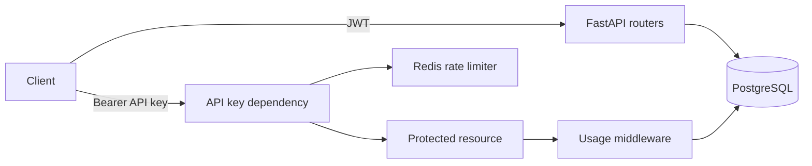

# API Key Management Service

A production-minded, multi-tenant API key platform built with FastAPI, PostgreSQL, SQLAlchemy 2, Redis, and Docker Compose. It lets developers register, manage applications and API keys, authenticate API-key traffic, enforce shared rate limits, and inspect usage.

## Architecture



Routes are intentionally thin. Services own authentication, resource lookup, key verification, rate limiting, and usage querying; SQLAlchemy models define persistence. All resource queries are scoped to the current user, avoiding IDOR.

## Run

```bash
cp .env.example .env
# Set unique, long JWT_SECRET and API_KEY_HMAC_SECRET values.
docker compose up --build
```

The Apple-inspired management dashboard is served at `http://localhost:8000`; Swagger UI remains at `http://localhost:8000/docs`. Compose waits for PostgreSQL and Redis health checks, then runs `alembic upgrade head` before Uvicorn. For a deployment migration run: `docker compose run --rm api alembic upgrade head`.

The dashboard is intentionally dependency-free: it is served by FastAPI and uses the same JWT-protected API routes as external clients. Register or sign in, create an application, then create, copy, and revoke API keys without leaving the interface.

## Main endpoints

| Area | Endpoints |
| --- | --- |
| Auth | `POST /auth/register`, `POST /auth/login`, `GET /auth/me` |
| Applications | `POST/GET /applications`, `GET/PATCH/DELETE /applications/{id}` |
| Keys | `POST/GET /applications/{id}/keys`, `GET/PATCH/DELETE /keys/{id}` |
| Usage | `GET /applications/{id}/usage`, `GET /keys/{id}/usage` |
| API-key example | `GET /protected/resource` |

Use the JWT as `Authorization: Bearer <token>` for management calls. Key creation returns `api_key` exactly once; retain it securely and use it as `Authorization: Bearer sk_live_...` for protected calls.

```bash
curl -X POST http://localhost:8000/auth/register -H 'content-type: application/json' \
  -d '{"email":"dev@example.com","password":"a-strong-password"}'
```

Usage endpoints support `skip`, `limit` (maximum 100), `start`, `end`, and `endpoint` filtering.

## Data model

`users 1—N applications 1—N api_keys 1—N usage_logs`. Foreign keys cascade on application/key removal. Indexed fields cover ownership, API-key prefix and expiry, and usage time/key/endpoint lookups.

## Security decisions

- Passwords use Argon2.
- JWTs expire (default 60 minutes) and are validated with HS256.
- Keys are random `secrets.token_urlsafe` values and their plaintext is never persisted.
- A server-side HMAC-SHA-256 hash is stored, so a database leak cannot verify keys without `API_KEY_HMAC_SECRET`. Rotating that secret requires a planned key rotation.
- Redis uses a per-key, minute-bucket atomic counter; defaults to 100 requests/minute and emits rate-limit headers on accepted protected requests.
- Revoked and expired keys are rejected; access-controlled lookups return 404 when resources are outside the caller’s tenancy.

## Development and tests

Python 3.12 is used inside Docker. The test suite uses an isolated SQLite database and FakeRedis; no development data is touched.

```bash
docker compose run --rm api python -m pytest -q
```

The project uses Alembic only for production schema creation—there is no application `create_all()` startup path.
